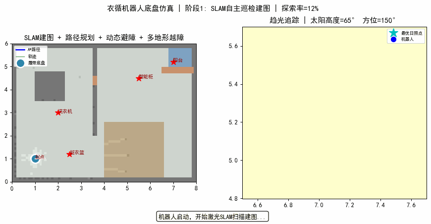
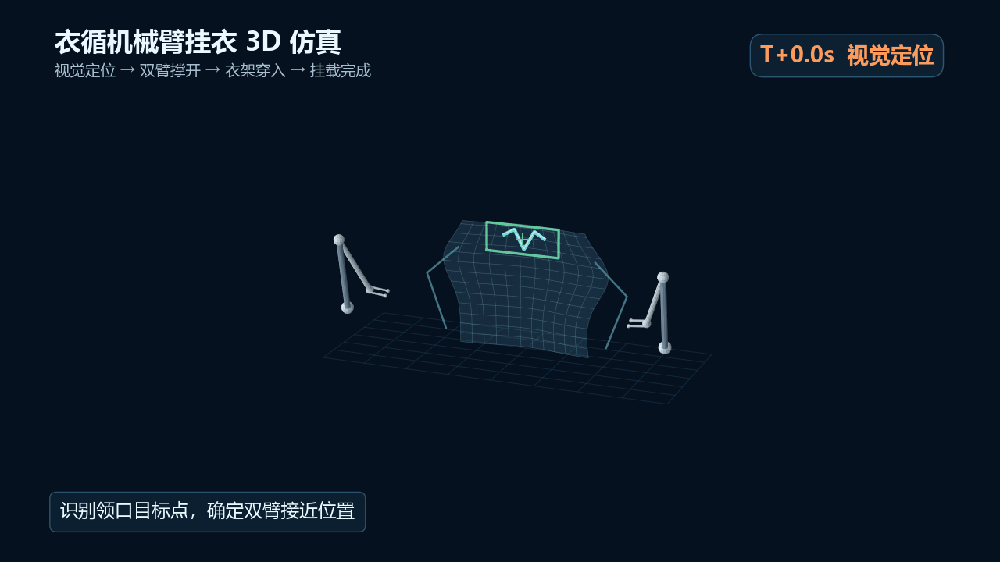
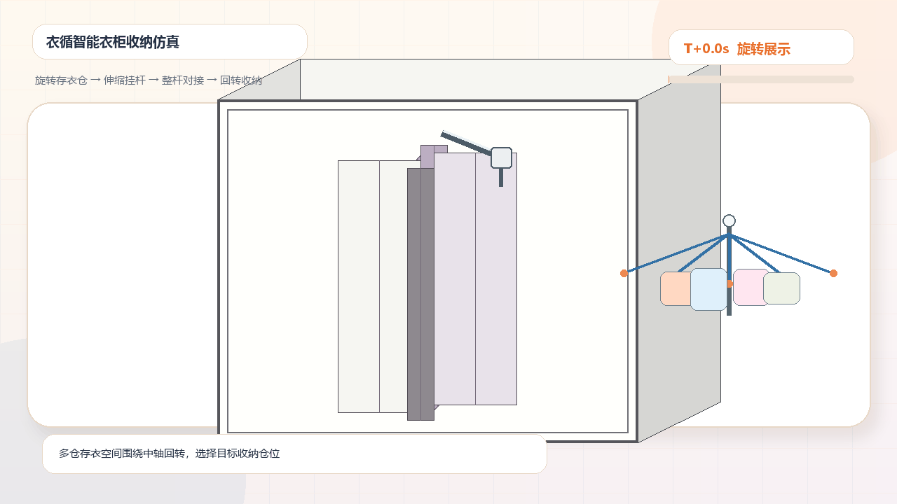
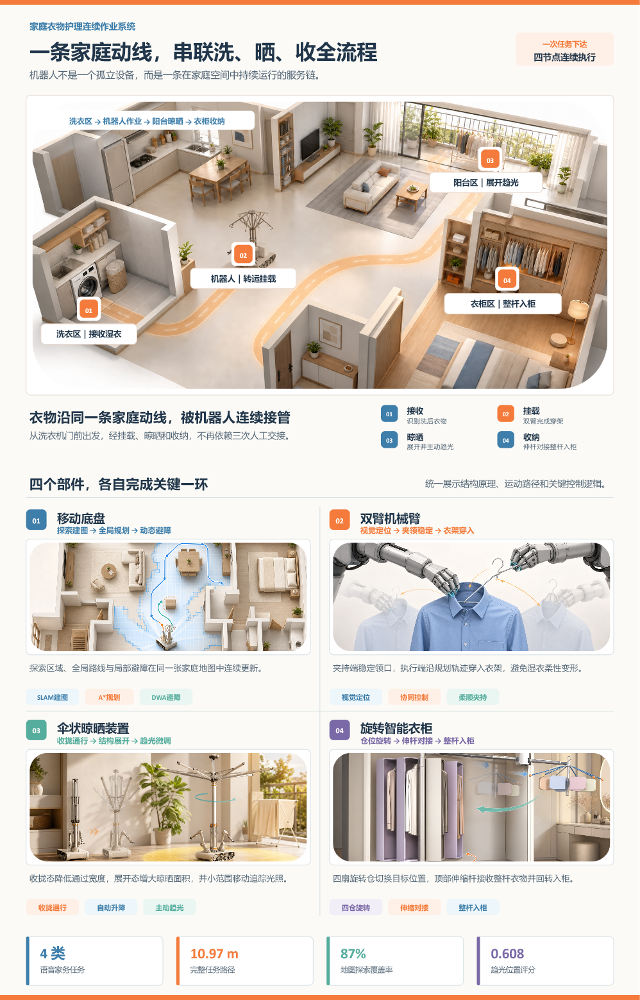
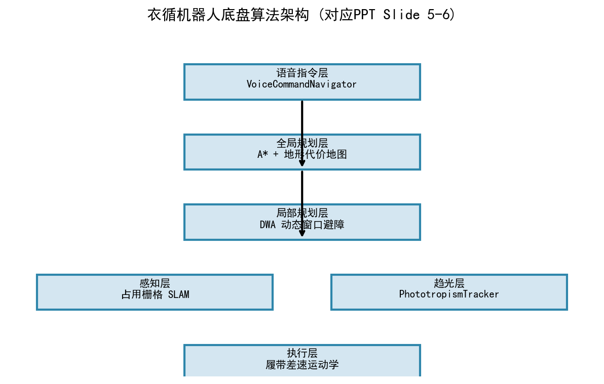

# 衣循 YIXUN · 洗晒收纳一站式服务机器人

> 把洗、晒、收三个原本割裂的家务环节，连成一条不断点的衣物动线。

第九届中国高校智能机器人创意大赛 · 主题赛一（家用智能机器人）参赛作品。

衣循不是又一台孤立的家电，而是一条在家庭空间中持续运行的服务链：它从洗衣区接收湿衣，经双机械臂完成衣架穿入与挂载，到阳台展开伞状晾晒装置并随光照微调位置，最终与旋转智能衣柜整杆对接，实现一键换季收纳。

---

## 核心指标

| 指标 | 数值 | 来源 |
| --- | --- | --- |
| 家庭语音任务 | 4 类 | 底盘仿真 |
| 完整任务路径长度 | 10.97 m | `assets/data/algorithm_summary.json` |
| 地图探索覆盖率 | 87 % | 同上 |
| 趋光位置评分 | 0.608 | 同上 |
| 仿真环境面积 | 48 m² | 底盘仿真场景 |

---

## 四个部件，各完成关键一环

| 部件 | 技术路线 | 代码位置 |
| --- | --- | --- |
| 移动底盘 | 占用栅格 SLAM → 融合地形代价的 A\* → DWA 动态避障 → 趋光定位 | `chassis/` |
| 双机械臂 | 视觉定位 → 一臂夹持领口 → 另一臂持衣架穿入 → 挂载完成 | `create_arm_hanging_3d_sim.py` |
| 伞状晾晒装置 | 收拢通行 → 结构展开 → 沿光照场梯度微调 | `chassis/phototropism.py` |
| 旋转智能衣柜 | 多仓旋转 → 挂杆伸出 → 整杆对接 → 回转入柜 | 已归档演示产物（见「已知限制」） |

---

## 目录结构

```
yixun-robot/
├── chassis/                     底盘算法模块（7 个）
│   ├── robot.py                 差速履带运动学
│   ├── terrain.py               多地形代价地图（门槛 / 地毯 / 滑轨）
│   ├── slam.py                  占用栅格 SLAM（Log-Odds）
│   ├── path_planner.py          A* 全局路径规划
│   ├── obstacle_avoidance.py    DWA 局部避障
│   ├── phototropism.py          太阳辐照度场 + 趋光搜索
│   └── voice_nav.py             语音指令语义地标解析
├── simulate_chassis.py          底盘综合仿真（生成动画 / 关键帧 / 数据）
├── create_arm_hanging_sim.py    机械臂挂衣二维仿真
├── create_arm_hanging_3d_sim.py 机械臂挂衣三维仿真
├── run_simulation_suite.py      三类仿真统一启动器
├── run_all_demo.py              一键运行可复现演示
├── export_algorithm_summary.py  导出算法数据摘要
├── tools/                       报告 / 图表的构建脚本（归档）
├── docs/                        设计报告、开发日志、汇报 PPT、算法说明
├── assets/
│   ├── demos/                   仿真动图与视频
│   ├── figures/                 论文级插图、关键帧、分镜
│   ├── poster/                  展板海报
│   ├── data/                    算法运行数据
│   └── app/                     家庭衣物护理 App 原型（HTML）
└── requirements.txt
```

---

## 快速开始

```bash
git clone <this-repo> && cd yixun-robot
pip install -r requirements.txt

# 列出全部仿真模块与技术路线
python run_simulation_suite.py --list

# 分别运行
python run_simulation_suite.py chassis     # 底盘导航
python run_simulation_suite.py arm         # 双机械臂挂载

# 一键运行可复现演示（底盘 + 数据摘要）
python run_all_demo.py
```

生成结果写入 `output/`（已加入 `.gitignore`），仓库内 `assets/demos/` 存放的是归档产物。

> 说明：`chassis` 与 `arm` 两个模块可直接运行；`wardrobe` 模块的生成脚本未归档，启动器会自动跳过并在终端提示，对应的 GIF / MP4 仍保存在 `assets/demos/` 中。

---

## 可视化预览

**底盘自主导航（SLAM → A\* → DWA → 趋光）**



**双机械臂三维挂载（夹领 → 持架 → 穿入 → 完成）**



**旋转衣柜整杆入柜**



**展板海报**



**算法架构图**



---

## 文档索引

| 文档 | 说明 |
| --- | --- |
| [作品详细设计报告（PDF）](docs/衣循_作品详细设计报告.pdf) | 完整技术方案：需求、构型、导航、操作、晾晒、收纳、验证 |
| [作品详细设计报告（DOCX）](docs/衣循_作品详细设计报告.docx) | 可编辑版本 |
| [产品开发日志（PDF）](docs/衣循_产品开发日志.pdf) | 开发过程、实验验证、问题闭环与版本迭代记录 |
| [作品汇报 PPT](docs/衣循_作品汇报.pptx) | 答辩用 11 页演示文稿 |
| [底盘移动算法说明](docs/算法说明.md) | 算法公式、参数与代码映射 |
| [仿真代码录屏说明](docs/仿真代码录屏说明.md) | 演示录制顺序与讲解口播 |

---

## 技术要点

**移动层**：以 Log-Odds 形式维护占用栅格，射线沿 Bresenham 路径更新自由 / 占用栅格；A\* 的代价函数在欧氏距离基础上叠加地形代价值，使"可通行"同时包含履带通过难度与载荷稳定性；DWA 在速度空间内采样并投影轨迹，实现与家庭成员共处时的动态避障。

**操作层**：采用"单臂夹持领口、单臂持衣架穿入"的协同策略，将柔性湿衣的变形与滑落风险拆解到两个可控自由度上，降低单一机构同时拉扯造成的褶皱。

**晾晒层**：把阳台光照建模为辐照度场，晾衣杆沿梯度方向搜索评分最高的位置，在展开状态下做小范围移动追踪。

**收纳层**：伞状晾衣杆与衣柜顶部伸缩挂杆整杆对接，避免晾晒完成后逐件取衣——这是把"晾晒"与"收纳"真正连成一环的关键接口。

---

## 已知限制

- 衣柜仿真的生成脚本 `create_wardrobe_storage_sim.py` 未随本仓库归档，`run_simulation_suite.py` 已做兼容处理（跳过并提示），归档产物见 `assets/demos/`。
- `tools/` 下为报告与图表的构建脚本，部分依赖原始素材目录（体积较大，未纳入仓库），缺少素材时会回退到已归档插图或显示占位说明。
- 所有结论均来自运动学与几何仿真，**不代表**真实样机的载荷、公差、湿衣力学与耐久性测试结果。

---

## 致谢与声明

本项目为课程 / 学科竞赛作品，文档与图纸中的市场数据引自公开统计与调研，仿真结论仅用于方案论证。仓库内不含任何个人身份信息。

## 许可

[MIT License](LICENSE)
